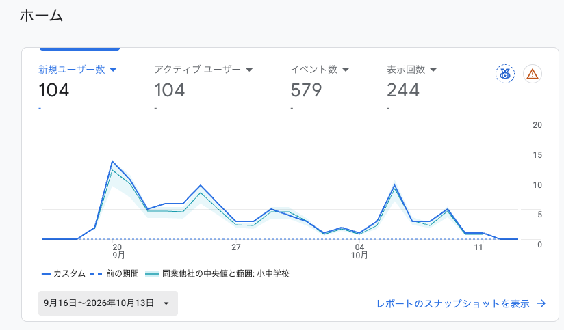
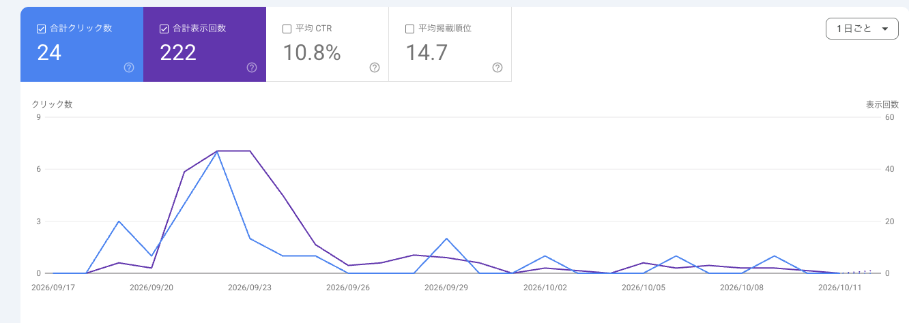

import Callout from '../../components/Callout.astro';
import HalfYearRoad from '../../components/diagrams/HalfYearRoad.astro';
import AdsensePayoutRoad from '../../components/diagrams/AdsensePayoutRoad.astro';

ブログを始めて、約1か月が経ちました。

先に結果を書いておくと、**収益は0円**です。Google AdSenseの審査にも1度落ちていて、広告を載せるスタートラインにすら立てていません。

それでも、ブログ自体は続いています。この記事で22本目です。

今回は、始めて1か月の時点での正直な気持ちと、実際のアクセス数、これからの目標を書いておきます。これからブログを始める人や、始めたばかりで数字が動かずに悩んでいる人に、「同じような人がいるな」と思ってもらえたらうれしいです。

そして何より、**半年後の自分が読み返して、答え合わせをするための記録**です。

## そもそも、なぜブログを始めたのか

学習の積み重ねを形に残したい、という話は[最初の記事](/blog/2026-09-16-start-blog/)に書きました。今回は、もう少し現実的なほうの理由です。

といっても、それほど大げさなものではありません。**何か副業を始めてみたい**と思ったときに、いくつか選択肢を考えて、その中でブログが気になりました。

- 比較的少ない初期投資で始められそうだった
- 自分の好きな時間に作業できそうだった
- 大掛かりな準備が必要なさそうだった
- 他の副業と比べて、続けやすそうに感じた
- 本業や日常生活と両立できそうだった
- 自分が経験したことや感じたことを、そのまま記事にできる

もうひとつ、私は以前、中学校の教員として働いていました。教員時代には学級通信を書く機会があり、**文章を書いて誰かに伝える**という行為そのものには、ある程度なじみがありました。それも、ブログを選んだ理由の1つです。

ただ、文章を書くことに慣れているからといって、ブログで収益を得られるとは限りません。学級通信は、配れば必ず読んでもらえます（たぶん）。ブログは、そもそも見つけてもらうところからです。

それでも、まずは趣味の延長として挑戦してみたいと思いました。「大きく稼ぎたい」というよりも、「**自分にもできるか試してみたい**」という気持ちが出発点です。

## ブログを始めて1か月。現在の状況

いまの状況を並べるとこうなります。

| 項目 | いまの状況 |
| --- | --- |
| 開設日 | 2026年9月16日 |
| 開設からの日数 | 28日目 |
| 公開した記事 | 22本（この記事を含む） |
| 収益 | 0円 |
| Google AdSense | 審査に落ちた（10月6日） |

収益化に成功したとは、とても言えない状況です。

それでも、ブログ自体は続けられています。最初の2週間はほぼ毎日書いていて、9月だけで15本。10月に入ってからは少し落ち着いて、**2〜3日に1本**くらいのペースです。

### 続けられているのは、AIのおかげ

これが実現できている理由の1つは、**AIを使っていること**です。

私はいまITエンジニアとして働いていて、Claude Codeを使ってブログを書く仕組みを整えています。具体的には、Claude Codeに[自分用のスキル](/blog/2026-09-21-claude-code-skill/)を作って、そこにブログの文章の雰囲気や好み、記事の作り方を書き溜めています。

流れはこうです。

1. 日常で感じたことや書きたいことを、**箇条書きで伝える**
2. Claude Codeがそれをもとに文章を組み立てて、ブログのフォルダの中に記事を作る
3. **内容の確認と最終判断は、自分でやる**

この記事も、その仕組みで書いています。

白紙から文章を書き始めるのは、思っているより腰が重いものです。箇条書きなら、書けます。**文章を書くことへの心理的なハードルが下がっている**のが、いちばん大きいと感じています。

## ブログはオワコンらしい。それでも続けてみたい

YouTubeやSNSでブログについて調べていると、いろいろな意見が目に入ります。

- 「今からブログを始めても稼げない」
- 「ブログはオワコン」
- 「AIの登場で個人ブログは厳しくなった」
- 「初心者が収益化するのは難しい」

こういうのを立て続けに見ていると、ブログを始めること自体に意味があるのか、少し考えてしまいます。

ただ、**私はまだ始めて1か月です**。

この段階で、ブログが稼げるかどうかを判断するのは早すぎると思っています。稼げないという意見があるのは分かりました。でも、自分ではまだ十分に試していません。

そもそも、最初から大きな収益を期待して始めたわけでもありません。趣味として楽しみながら、もし収益が発生したらうれしい。まずは、そのくらいの気持ちで続けてみます。

## とりあえず半年間、100記事を目指してみる

同じようにYouTubeやSNSを見ていると、こんなアドバイスもよく見かけます。

- 「まずは3か月続けてみよう」
- 「最低でも半年間は継続しよう」
- 「100記事を書いてから考えよう」

これを、自分の目標として借りてみることにしました。

半年や100記事という数字に、必ずうまくいく根拠があるとは思っていません。あくまで、SNSやYouTubeで見かけた経験則です。それでも、**区切りがあったほうが続けやすい**ので、目印として置いておきます。

<HalfYearRoad />

開設が9月16日なので、半年後は**2027年3月16日**です。そこまで、あと154日あります。

ここで計算してみました。

| これからのペース | 半年後の記事数 |
| --- | --- |
| 3日に1本 | 約73本 |
| 2日に1本 | 約99本 |

いまのペースに近い3日に1本だと、**半年後は70本ちょっと**。100記事には届きません。届かせるには、2日に1本でぎりぎりです。

とはいえ、数を合わせるために無理に書いて、中身が薄くなるのは避けたいです。なので順番はこうします。**まずは半年続けること。100記事は、その先に置いておく。**

「半年続けたら、自分のブログはどうなっているんだろう？」

そんな好奇心も、続ける理由の1つです。

## ブログ初心者のリアルなアクセス数を公開

さて、ここからが本題です。

ブログを始めて1か月。気になるアクセス数はこちら！

……うん、まあ、こんなものですよね（笑）

まだまだ、インターネットの片隅でひっそり営業中です。

### Googleアナリティクスの数字

集計期間は、開設した9月16日から10月13日までにしています。ただ、アナリティクスを入れたのは9月19日の夜なので、実際に数えられているのは**そこからの約25日分**です。

| 指標 | 数字 |
| --- | --- |
| アクティブユーザー | 104 |
| 新規ユーザー | 104 |
| 表示回数 | 244 |
| イベント数 | 579 |

それぞれ、数えているものが違います。

- **アクティブユーザー**：期間中にブログを訪れたユーザーのうち、初めての訪問か、10秒以上の滞在などが記録されたユーザーの数。同じユーザーは何度来ても1と数える
- **新規ユーザー**：期間中に初めて訪れたユーザーの数
- **表示回数**：ページが表示された回数の合計
- **イベント数**：ページの表示やスクロールなど、記録された動きの合計

数字を見て思ったことを、順番に書きます。

**25日で104人なので、新しく来てくれた人は1日あたり4人くらいです。** [アナリティクスを入れたとき](/blog/2026-09-25-google-analytics-search-console/)に「1日数人」と書きましたが、1か月たってもそのままでした。桁は増えていません。

**アクティブユーザーと新規ユーザーが、同じ104です。** 全員が、この期間に「はじめまして」だった人ということになります。1か月前にはこのブログ自体が存在していなかったので、それはそうです。

**表示回数を人数で割ると、1人あたり2.3回くらいになります。** 同じページを開き直した分も入るので言い切れませんが、1ページだけ見て帰る人ばかりではなさそうです。これは素直にうれしいです。

**イベント数の579は、いちばん大きい数字ですが、いちばん喜んではいけない数字です。** これは読んだ人の数でも、読まれた回数でもありません。1人が1ページを開くだけで、「ページを表示した」「訪問が始まった」「初めて来た」といった動きがそれぞれ1件ずつ記録されます。ページの下のほうまでスクロールしたときにも増えます。なので、人数よりずっと大きくなるのが普通です。

<Callout type="note">
	数字は、少し割り引いて見ています。理由は2つあります。

	- Googleアナリティクスの「ユーザー」は、実際の人数とは限りません。同じ人でも、**ブラウザや端末が違うと別のユーザーとして数えられる**ことがあります
	- 自分のアクセスを除外する設定をしたのは、開設してしばらく経ってからでした。**最初のころの数字には、自分で開いた分も混ざっています**。グラフの最初の山は、そのぶん高く出ていそうです
</Callout>

### Search Consoleの数字

次は、Google検索の中でどう見えているかです。同じく開設からの約1か月分です。

……こちらも、ひっそりしています（笑）

| 指標 | 数字 |
| --- | --- |
| 合計表示回数 | 222 |
| 合計クリック数 | 24 |
| 平均CTR | 10.8% |
| 平均掲載順位 | 14.7 |

- **合計表示回数**：Google検索の結果に、このブログのページが出た回数
- **合計クリック数**：そのうち、クリックされてブログが開かれた回数
- **平均CTR**：表示されたうち、クリックされた割合（クリック数 ÷ 表示回数）
- **平均掲載順位**：検索結果の上から何番目に出ていたかの平均

**1か月で、検索結果に出たのが222回。そのうちクリックされたのが24回です。** 世の中で1日に行われている検索の数を思うと、砂浜の砂ひと粒くらいの話です。それでも、24回は誰かが検索結果の中からこのブログを選んでくれた、ということになります。

**平均CTRの10.8%は、数字だけ見ると悪くなさそうです。** 10回表示されたら1回はクリックされている計算です。ただ、もとの数が222回と小さいので、数人の動きで大きく変わります。まだ「高い」「低い」を言える段階ではなさそうです。

**平均掲載順位は14.7でした。** 検索結果が1ページ10件だとすると、2ページ目のまんなかあたりです。2ページ目までめくって探す人は、そう多くなさそうです。クリックが少ないのも納得です。

**グラフを見ると、9月22日から23日ごろに山があって、そのあとは静かです。** 山のあとは、表示が1日に数回、クリックは0回の日のほうが多くなっています。

<Callout type="note">
	Search Consoleの数字も、少し割り引いて見ています。

	- Search Consoleには、自分のアクセスを除外する設定がありません。**自分で検索して開いた分があれば、それも入っています**
	- 集計には数日の遅れがあります。グラフの右端が点線になっているのは、直近の数日分がまだ確定していないためです
</Callout>

アナリティクスのユーザーは104、検索からのクリックは24でした。2つの道具は数え方が違うので単純には比べられませんが、**検索から来た人より、それ以外から来た人のほうが多い**ようです。検索で見つけてもらうのは、まだまだこれからです。

## 収益化への道のりは、まだまだ遠そう

アクセス数の次は、お金の話です。

Google AdSenseには、9月22日に申請しました。結果が来たのは10月6日で、**不承認**でした。通知に書かれていた理由は「有用性の低いコンテンツ」です（このときの気持ちは[別の記事](/blog/2026-10-09-effort-becomes-career/)に少し書きました）。

つまり、そもそも、まだ広告を掲載するスタートラインにも立てていません。

しかも調べてみると、審査に通ったとしても、**収益が8,000円に到達しないと振り込まれない**らしいのです。

<AdsensePayoutRoad />

<Callout type="note">
	AdSenseには「お支払い基準額」があり、日本円の場合は8,000円です（2026年10月時点。[AdSenseヘルプ「お支払い基準額」](https://support.google.com/adsense/answer/1709871?hl=ja)）。収益の残高がこの金額に届いてから、支払いの対象になります。
</Callout>

### 仮に計算してみる

では、8,000円に届くのはいつなのか。審査に通っていないので実績はありませんが、**仮の数字を置いて**計算してみます。

<Callout type="warning" title="ここからは仮定の話">
	「ページが1,000回表示されると300円の広告収益になる」と仮に置きます。この300円は計算のために置いた数字で、**このブログの実績ではありません**。実際の金額は、ジャンルや時期によって大きく変わるそうです。
</Callout>

1. 1回の表示あたり：300円 ÷ 1,000回 ＝ **0.3円**
2. この約1か月分：244回 × 0.3円 ＝ **約73円**
3. 8,000円に届くまで：8,000円 ÷ 73円 ＝ **約110か月**

**約110か月。9年ちょっとです。**

……初めての振り込みは、いったいいつになるのでしょうか（笑）

もちろんこれは、アクセス数がいまのまま1ミリも増えなかったら、という計算です。記事が増えれば、数字も変わるはずです。変わらなかったら、それはそれで半年後の記事のネタになります。

AdSenseのほうは、記事がもう少し増えてから、もう1度審査に出してみるつもりです。

## 半年後、このブログはどうなっているのだろう

いまの時点での目標は、4つです。

1. **ブログを半年間、続けること**
2. **記事数を少しずつ増やしていくこと**
3. **GoogleアナリティクスやSearch Consoleの数字がどう変わるのか、観察すること**
4. **ブログ運営そのものを楽しむこと**

そして、もし収益が発生したら、それはもちろんうれしいです。

ただ、収益が発生しなかったとしても、半年続けたという経験や、記事を書くために作ったAIの仕組みは、手元に残ります。文章を書くこと、情報を整理すること、AIを使うこと。ブログを運営しながら、このあたりを少しずつ学んでいけたら、それだけでも自分にとっては意味があります。

### ブログ運営記録（1か月目）

半年後に比べられるように、2026年10月13日時点の数字をまとめておきます。収益が出ていない時期の数字は、あとからは取り直せません。

| 項目 | 1か月目 |
| --- | --- |
| 開設からの日数 | 28日目 |
| 公開した記事 | 22本 |
| アクティブユーザー | 104 |
| 表示回数 | 244 |
| イベント数 | 579 |
| 検索での表示回数 | 222 |
| 検索からのクリック数 | 24 |
| 平均CTR | 10.8% |
| 平均掲載順位 | 14.7 |
| Google AdSense | 不承認 |
| 収益 | 0円 |

アクティブユーザー・表示回数・イベント数はGoogleアナリティクスの数字で、計測を始めた9月19日からの合計です。検索の4項目はSearch Consoleの数字です。

開設から3か月と半年のタイミングで、同じ項目で続きを書きます。増えていても、増えていなくても、書きます。

### 半年後の自分へ

> 半年後の自分へ。
>
> ブログは続いていますか？
>
> 100記事には到達しましたか？
>
> Google AdSenseには合格できましたか？
>
> そして、初めての収益は発生しましたか？
>
> 今の私は、まだ何も結果を出せていません。それでも、ブログを書くこと自体は意外と楽しめています。
>
> 半年後、この記事を読み返したときに、少しでも成長したと思えたらうれしいです。
>
> ……できれば、収益も少しくらい発生していてほしいですけどね（笑）

同じように始めたばかりの人がいたら、半年後、一緒に答え合わせをしましょう。
